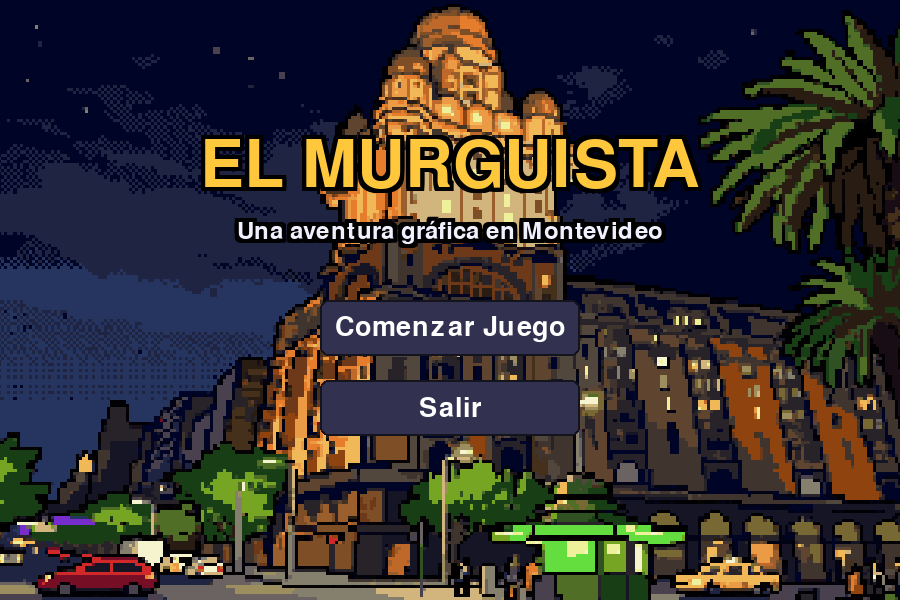
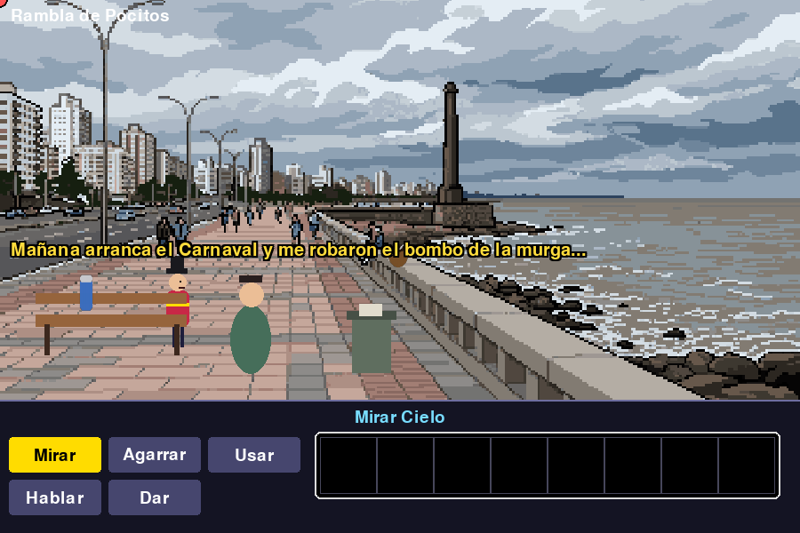
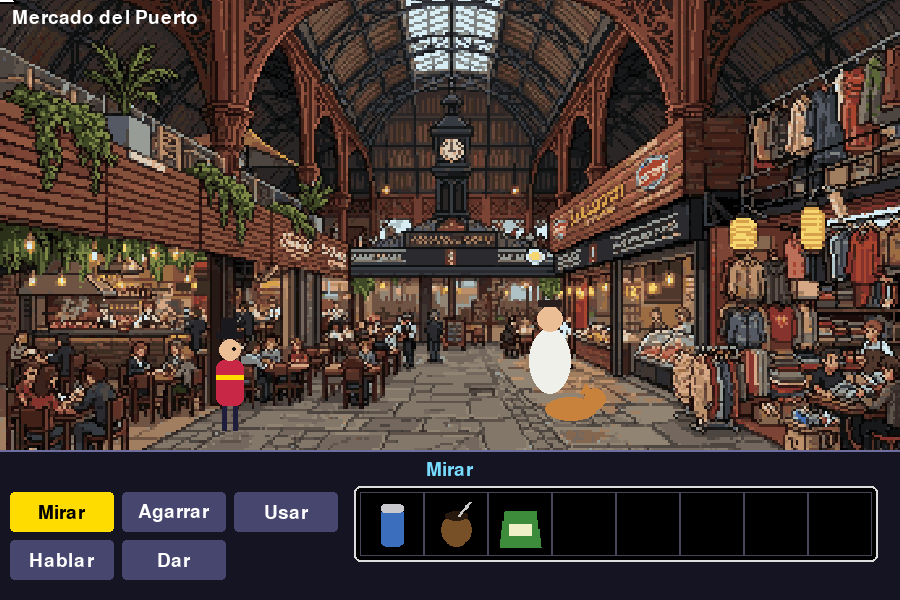
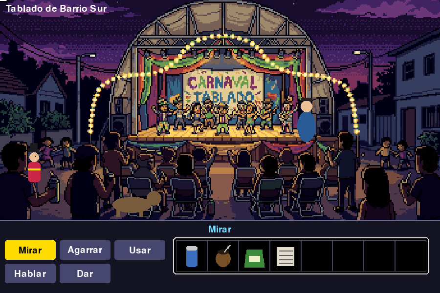
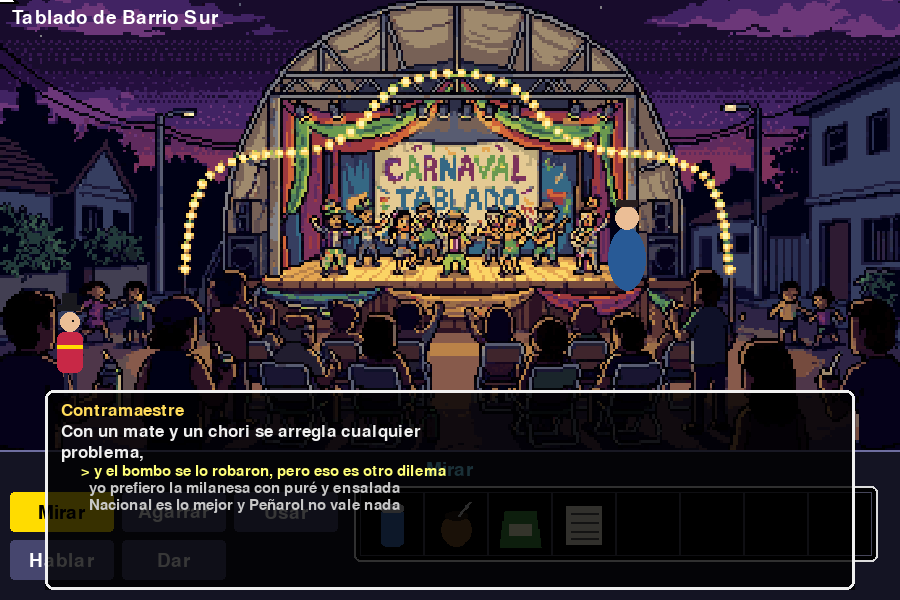

<div align="center">



# 🥁 EL MURGUISTA
### *Una aventura gráfica en Montevideo*


**Videojuegos 2D · Tecnólogo en Informática · 2026**

</div>

---

## 📜 La historia

Faltan dos días para el Carnaval y **robaron el bombo** de la murga *Los Sin Tablado*.
**Tano**, aspirante a murguista, tiene que recorrer la **Rambla de Pocitos**, el **Mercado del Puerto**
y el **Tablado de Barrio Sur** para recuperarlo... bajo la lluvia de El Niño, con la ropa que no se seca
y un perro que solo entiende de **chori al pan**.

> *«Y encima llueve desde que empezó la primavera... gracias, Niño.»* — Tano

Humor uruguayo de punta a punta: mate, termo, candombe, dichos y frases populares, y un duelo de **payada** final.

---

## 🕹️ Cómo se juega

Point-and-click al estilo **Monkey Island**: elegís un verbo, después el objeto (o el personaje) y Tano lo hace.

<p align="center">


</p>

```
> Usar Mate cargado con Termo
```

| Acción | Cómo |
|---|---|
| Caminar | Clic en una zona libre del escenario |
| Interactuar | Verbo → objeto / personaje (Tano camina hasta ahí) |
| Usar / Dar un ítem | Verbo → ítem del inventario → objetivo |
| Combinar ítems | **Usar** → ítem → otro ítem |
| Cancelar el ítem elegido | Clic derecho |
| Saltar un texto | Clic |
| Diálogos | Elegís la opción con el mouse |

---

## 🖼️ Capturas

<table>
<tr>
<td align="center"><br><sub><b>Rambla de Pocitos</b></sub></td>
<td align="center"><br><sub><b>Mercado del Puerto</b></sub></td>
</tr>
<tr>
<td align="center"><br><sub><b>Tablado de Barrio Sur</b></sub></td>
<td align="center"><br><sub><b>El duelo de payada</b></sub></td>
</tr>
</table>

---

## 🧩 Qué tiene

- 🗺️ **3 escenarios** conectados, con zona navegable y escala del personaje según la profundidad
- 🎯 **5 verbos** y un comando que se arma solo («Dar Chori al pan a Perro»)
- 🎒 **Inventario con combinación** de ítems (yerba + mate + termo = mate listo)
- 💬 **Diálogos con opciones múltiples**, elegidas con el mouse
- 🧠 **3 puzles**: el mate, el chori al pan y la payada final
- 🎤 **Duelo de payada**: elegís la rima correcta; tres errores y es **Game Over**
- 🔊 **Sonido en cada interacción** (clics, diálogos, ítems)
- 🏁 Pantallas de **Inicio**, **Game Over** y **Victoria**, con volver al menú

<details>
<summary>⚠️ <b>Spoiler:</b> cómo se resuelve</summary>

1. **Rambla:** agarrá el **termo** (banco), el **mate** (muro) y el **diario** (tacho). Hablá con el pescador para la pista.
2. **Mercado:** agarrá la **yerba**. Combiná **yerba + mate** y el resultado con el **termo** para tener un *mate listo*. **Dale el diario** al parrillero: prende la parrilla y te da un **chori al pan**.
3. **Tablado:** **dale el chori al perro** (libera el paso) y **el mate listo al Contramaestre**.
4. **Payada:** cuatro versos, elegí la rima que cierra bien. Con tres errores perdés. Si ganás, **agarrá el bombo**.

</details>

---

## ▶️ Cómo correrlo

Requiere **Python 3.10+**. Desde esta carpeta:

```bash
cd brain/juego
python3 -m venv .venv
source .venv/bin/activate        # en Windows: .venv\Scripts\activate
pip install -r requirements.txt
python -m aventura.main
```

Prueba automática (juega la partida completa sin ventana):

```bash
python tests/smoke_test.py
```

---

## 📊 Estado del proyecto

<!-- ESTADO:INICIO — este bloque lo mantiene el agente (ver brain/AGENTS.md §8) -->
**Última actualización: 2026-10-25** · Entrega final: **6 de noviembre de 2026**


| Requisito | Estado |
|---|---|
| Verbos de acción | ✅ |
| Inventario con combinación | ✅ |
| ≥ 3 escenarios con zonas navegables | ✅ |
| Diálogos con opciones múltiples | ✅ |
| ≥ 2 puzles | ✅ (3) |
| Máquina de estados y hotspots | ✅ |
| Inicio / Game Over / Victoria | ✅ |
| Sonido en toda interacción | ✅ |
| Fondos | ✅ pixel art (los 4) |
| Sprites de personajes y objetos | ⏳ figuras geométricas provisorias |
| Música | ⏳ pendiente |
| Video de 15 a 40 s | ⏳ pendiente |
<!-- ESTADO:FIN -->

---

## 🛠️ Detrás de escena

- **Motor del curso** (`brain/juego/engine/`) con extensiones documentadas: máscara de caminabilidad, combinación de ítems, diálogos con mouse y texto flotante con color por personaje.
- **Un solo `GameScene`** parametrizado por datos: escenarios y hotspots (`aventura/data/rooms.py`), diálogos (`dialogs.py`) e ítems y recetas (`items.py`).
- **Arte con respaldo:** si existe el PNG se usa; si no, se dibuja un placeholder geométrico (`aventura/art.py`).
- Documentación de diseño y decisiones en la wiki: [`brain/wiki/`](brain/wiki/index.md) · [`brain/decisions.md`](brain/decisions.md).

```
TAREA/
├── README.md              ← este archivo
├── capturas/              ← capturas del juego (se regeneran con tools/capturas.py)
└── brain/
    ├── juego/             ← el juego (engine/ + aventura/ + tests/)
    ├── wiki/              ← diseño, requisitos, motor, entrega
    └── tools/             ← lint, sonidos, capturas
```

## 🎨 Créditos y assets

- **Fondos:** pixel art creado con IA mediante **Pixellab** (Rambla, Mercado, Tablado y menú).
- **Sonidos:** generados por código (ondas simples), sin licencias externas.
- **Personajes y objetos:** provisorios, dibujados por código.
- **Motor:** el del curso Videojuegos 2D 2026.
- Lista completa con origen y licencia: [`brain/wiki/entrega/assets-lista.md`](brain/wiki/entrega/assets-lista.md).

<div align="center">

*¡Que empiece el Carnaval!* 🎺

</div>
